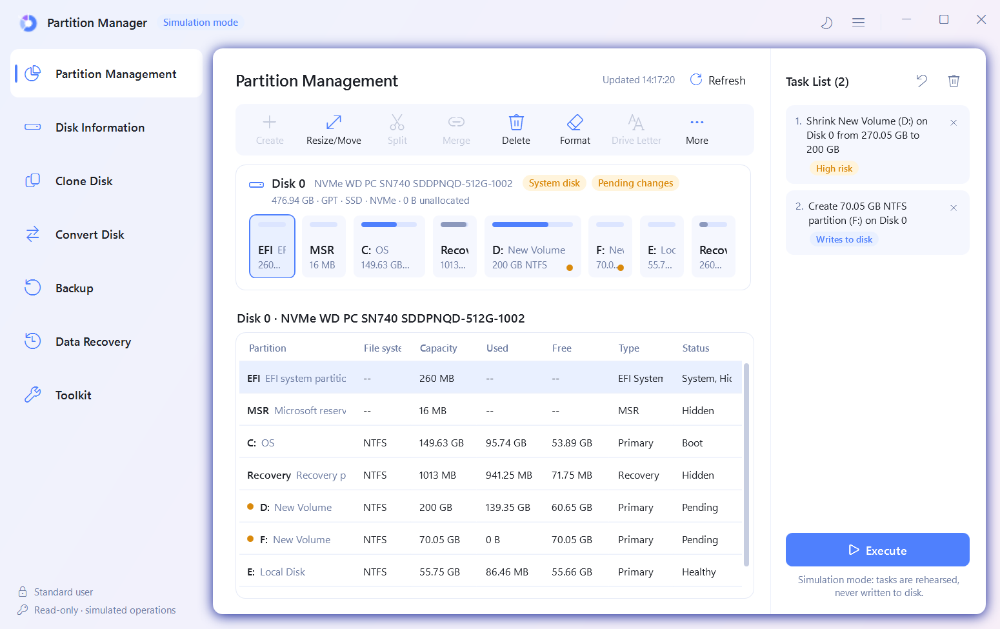

# Partition Manager

Development planning: [v0.5.0 hardening and E:-only testing policy](docs/V0.5.0_DEVELOPMENT_PLAN.md).
Physical testing is blocked pending backup/restore verification, VHDX validation,
independent review and explicit consent for one exact operation.

A Windows disk, partition and **data recovery** tool written from scratch in C#/WPF (.NET 8). Its layout and
workflows follow a commercial partition tool (analysed in [docs/ANALYSIS.md](docs/ANALYSIS.md)), but it contains no
code, assets or branding from it.

**Status: 0.5.1-preview engineering build. Release gates remain open; not production-ready.** Current gate: [ReleaseGate-0.5.1](docs/reports/ReleaseGate-0.5.1.md) (installed-VM security results in [SecurityHardening-0.5.1](docs/reports/SecurityHardening-0.5.1.md)). See [Milestone 4](docs/reports/Milestone4.md) and [E: readiness](docs/reports/E_PHYSICAL_TEST_READINESS.md). Physical writes remain disabled. [All 7 elevated VHDX tests now pass](docs/reports/ProductionHardening-20261107.md), including GPT/MBR journal integration and 1003 verified file hashes.



## What works, and how it was tested

| Feature | Status | Evidence |
|---|---|---|
| Disk and partition discovery, disk map, partition table, properties | Works (read-only) | Live WMI test, UI smoke test |
| **Recover deleted files (NTFS)** | **Works on real volumes** | E: run: 4 deleted files (300 B to 24 MiB, including a deleted subfolder) recovered with matching SHA-256 |
| **Find lost partitions** (NTFS, FAT32, exFAT) | **Works (read-only scan)** | A deleted partition on a VHDX was found at its exact original offset and size |
| Change label; assign, change and remove drive letter; **create, format, delete, shrink, extend, split** | **Tested on virtual disks only** (real Windows storage calls through the elevated helper) | GPT and MBR VHDX runs with independent `Get-Partition`/`Get-Volume` checks and SHA-256 file checks ([report](docs/reports/runs/StructuralRun-20261107-141235.md)) |
| Any write to a **physical** disk (including E:) | **Disabled.** Simulated only; the helper refuses physical disks | See [E:-only authorization design](docs/E_ONLY_AUTHORIZATION_DESIGN.md) (design only) |
| Initialize GPT/MBR | Implemented; fresh blank-image approval required | Helper engine and virtual-disk integration |
| Move, merge, delete-all, hide/show | Simulated; real Move/Merge blocked | [Technical blockers](docs/MOVE_MERGE_LIMITATIONS.md) |
| Clone, backup, OS migration, MBR/GPT conversion | Not implemented (placeholder pages) | – |

**Measured speed** (Release build, i5-11260H, NVMe). Scanning a 270 GB volume for deleted files read 321,280 MFT
records in 0.98 s. Recovering a 24 MiB file took 45 ms. Searching a 512 MB disk for lost partitions took 22 ms.
App start to a populated disk map takes about 1.2 s. See [docs/reports/Performance.md](docs/reports/Performance.md).
I haven't benchmarked the reference product, so no comparison is claimed.

### How data recovery works
1. *Data Recovery → Deleted files*. Choose a drive and press **Scan**. The app reads the drive's Master File Table
   directly (raw, read-only) and lists every deleted file whose record survives. It shows the original folder, size,
   modified date and a recovery chance:
   * **Excellent:** the data is inside the MFT record.
   * **Good:** none of the file's clusters have been reused.
   * **Partly overwritten** or **Overwritten:** some or all clusters have been reused.
2. Tick files (or use the filter and *Select all shown*), press **Recover selected** and pick a folder on a
   **different** drive. Saving to the scanned drive is refused, because it could overwrite what you're recovering.
   Folder structure and modified dates are restored, and existing files are never overwritten.
3. *Data Recovery → Lost partitions*. Choose a disk and press **Search unallocated space** to find boot sectors of
   deleted or lost NTFS, FAT32 and exFAT partitions.

Raw disk reads need administrator rights. The page has a **Restart as administrator** button, and scanning never
changes the source drive.

**Recovery limits:** NTFS only, so no FAT/exFAT file recovery yet. Very large or heavily fragmented files whose
layout spans several MFT records are listed as "Not supported yet". There is no file carving for files whose MFT
record has been reused, and no restore of found lost partitions (scan only).

### Safety
* Real partition writes are **off by default** and only possible on VHD/VHDX virtual disks inside a folder an
  administrator approves. **Physical disks are never written.** No setting enables it.
* Writes go through a separate elevated helper (`PartitionManager.Helper.exe`). It re-checks disk identity
  (unique ID, serial number, size, layout fingerprint) and the safety rules before writing, verifies the result,
  and writes an audit log. See [docs/reports/SecurityAudit.md](docs/reports/SecurityAudit.md).
* The app refuses to delete or format the running Windows, EFI, MSR or recovery partitions, to move the boot
  volume, or to restructure BitLocker volumes.

---

## Run the project from source: step by step

### 1. Prerequisites
1. Windows 10 (1809 or later) or Windows 11, x64.
2. **.NET 8 SDK.** Install one of these ways:
   * `winget install Microsoft.DotNet.SDK.8`, or
   * download it from https://dotnet.microsoft.com/download/dotnet/8.0, or
   * per user, without admin, in PowerShell:
     ```powershell
     Invoke-WebRequest https://dot.net/v1/dotnet-install.ps1 -OutFile $env:TEMP\dotnet-install.ps1
     & $env:TEMP\dotnet-install.ps1 -Channel 8.0 -InstallDir "$env:USERPROFILE\.dotnet"
     $env:PATH = "$env:USERPROFILE\.dotnet;$env:PATH"; $env:DOTNET_ROOT = "$env:USERPROFILE\.dotnet"
     ```
     With the per-user option, run the last line in every new terminal (or add it to your profile).
3. Check it works: `dotnet --list-sdks` should show an `8.0.x` entry.
4. Optional: Git, to clone. Inno Setup 6, only to build the installer. Visual Studio 2022 or VS Code with C# Dev Kit
   for editing (open `PartitionManager.sln`).

### 2. Get the code
```powershell
git clone https://github.com/Karthickcjx/partition-manager.git
cd partition-manager
```

### 3. Build
```powershell
dotnet build PartitionManager.sln
```
Expected: `Build succeeded` with 0 errors. The first build downloads NuGet packages, so it needs internet.

### 4. Run the app
```powershell
dotnet run --project src\Desktop\PartitionManager.Desktop.csproj
```
or start the built exe directly:
```powershell
.\src\Desktop\bin\Debug\net8.0-windows\win-x64\PartitionManager.exe
```
Useful switches (after `--` when using `dotnet run`): `--demo` (sample disks), `--dark` and `--light` (theme),
`--page=5` (open Data Recovery).

### 5. Use data recovery
1. In the sidebar choose **Data Recovery**.
2. Click **Restart as administrator** and approve the Windows prompt.
3. Choose the drive, press **Scan**, select files, press **Recover selected**, and choose a folder on another drive.

Alternatively, open an administrator terminal and run the exe directly.

### 6. Run the tests
```powershell
dotnet test PartitionManager.sln
```
Ordinary tests run without writing to real volumes; VHDX tests require explicit opt-in and elevation. See the current report for measured counts. Then the
UI check:
```powershell
powershell -ExecutionPolicy Bypass -File scripts\ui-smoke.ps1
```
This drives the app through Windows UI Automation (no mouse or keyboard input) and saves screenshots to
`docs\screenshots`.

### 7. Run disposable virtual-disk tests (administrator)
```powershell
powershell -ExecutionPolicy Bypass -File scripts\run-vhd-integration.ps1
```
The script requests UAC, verifies `D:\PartitionManager-TestDisks` and free space,
creates only its own dynamic VHDX images, and detaches and identity-checks them
before deletion. It never uses C:, D: or E: as a target volume. Recovery tests on
physical volumes are excluded. The larger test uses a 16 GiB dynamic image; the
geometry rehearsal uses a sparse image matching the inspected host capacity.
Reports are under `artifacts/reports`. Host partition layouts are inspected
read-only; no private host data is copied.

### 8. Build a release (optional)
```powershell
powershell -ExecutionPolicy Bypass -File scripts\build-release.ps1
```
This produces `artifacts\publish\PartitionManager.exe` and `PartitionManager.Helper.exe` (self-contained, no .NET
needed), `artifacts\installer\PartitionManager-0.4.0-alpha-x64-setup.exe` (if Inno Setup 6 is installed),
SHA-256 checksums, an SBOM and a vulnerability report.

### 9. Enable real partition writes on virtual disks (optional, administrator)
```powershell
scripts\configure-test-environment.ps1 -ImageRoot D:\PartitionManager-TestDisks # protected installed build
scripts\configure-test-environment.ps1 -Disable                             # turn it off again
```

### Troubleshooting
* **"You must install .NET"** when starting a dev build: set `DOTNET_ROOT` as in step 1, or use the self-contained
  release exe.
* **Data Recovery's Scan button is disabled:** the app isn't running as administrator (see step 5).
* **"Choose another drive":** the recovery destination is on the drive being scanned. Pick a different drive.
* **A build copies an old exe:** close any running PartitionManager first, then rebuild.

## Project layout
```
src/
  Core/             Pure logic: models, GPT/MBR parsers, layout, operations, safety policy, simulator,
                    Execution/ (disk identity, write requests, IPC protocol), Recovery/ (NTFS scanner, file recoverer,
                    lost-partition scanner)
  Infrastructure/   WMI discovery, raw disk and volume readers, BitLocker probe, logging, helper client
  PrivilegedHelper/ Elevated helper: write pipeline, WMI writes, audit log, IPC session
  Desktop/          WPF app (Views, ViewModels, Themes)
  Tests/            xUnit: unit, IPC/security, failure injection, synthetic NTFS images, real VHDX and real-volume tests
installer/          Inno Setup script
scripts/            build-release, ui-smoke, run-vhd-integration, measure-performance, configure-test-environment
docs/               ANALYSIS, FEATURES, PRODUCTION_AUDIT, reports/, screenshots/
```

## Known limitations
* Binaries aren't code-signed, so UAC shows "Unknown publisher".
* Real label/letter, create, format, delete, shrink, extend, split and initialization are restricted to approved virtual disks. Move/Merge remain simulated. Initialization additionally needs a fresh administrator-issued blank-image approval; there is no UI provisioning flow yet.
* Data recovery covers NTFS only; see the recovery limits above. The scan from inside the elevated app UI was
  checked visually but isn't covered by an automated elevated UI test.
* English only. No screen-reader or 150%/200% DPI audit yet. Memory use is about 290 MB.

Historical recovery/performance measurements above are v0.3 evidence, not fresh Milestone 3 measurements. No recovery test or private-data scan on E: was performed in Milestone 3.
